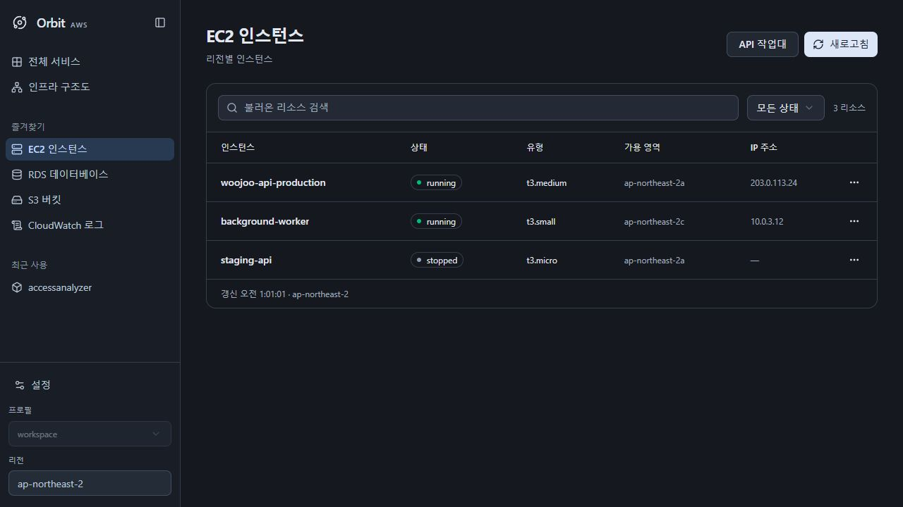
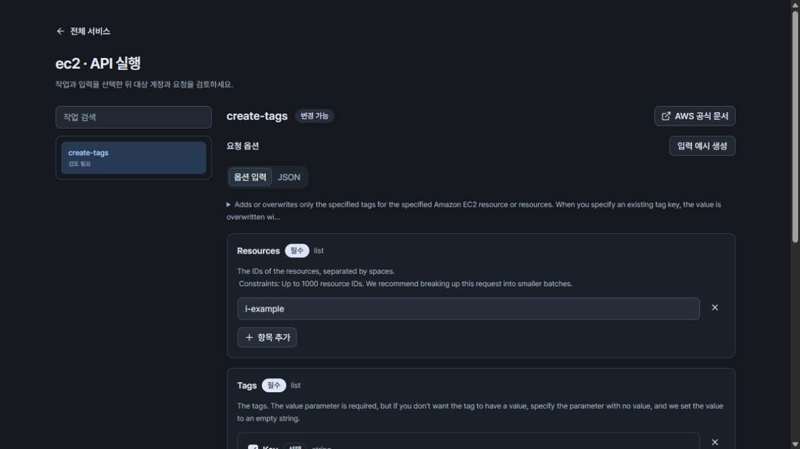
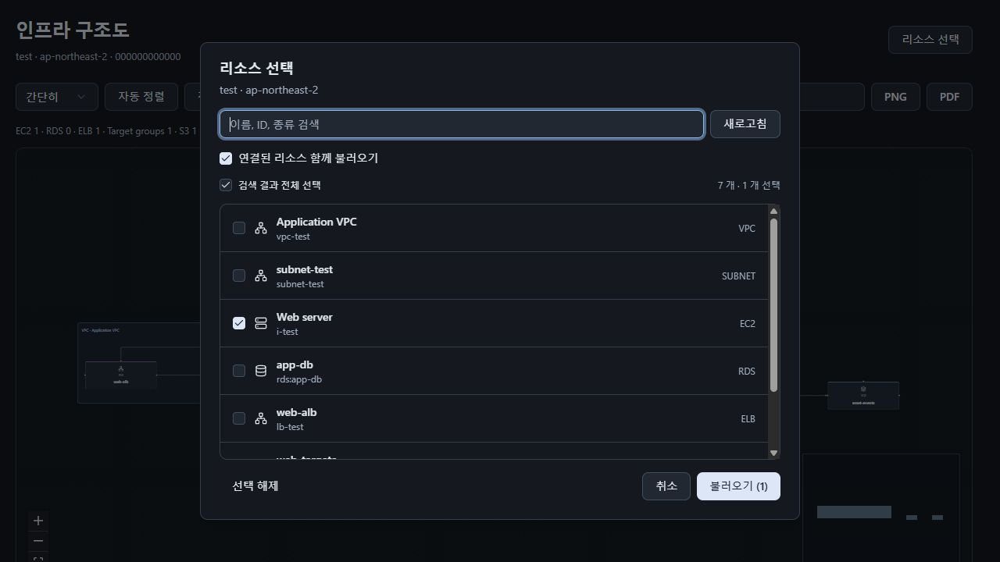
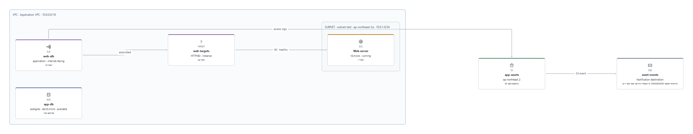

# Orbit

**A desktop AWS workspace powered by your local AWS CLI.**

[한국어](README.md) · English

[Download](https://github.com/leessang10/aws-gui/releases/latest) · [Release notes](docs/releases/v0.1.0.md) · [Report a bug](https://github.com/leessang10/aws-gui/issues) · [MIT License](LICENSE)

Browse resources, read logs and inspect infrastructure relationships from one desktop app. Orbit uses your installed AWS CLI and existing profiles. Built with Tauri 2, Rust, React and TypeScript.



## Features

| Feature            | What you can do                                                                                                                                              |
| ------------------ | ------------------------------------------------------------------------------------------------------------------------------------------------------------ |
| Resource browsing  | Inspect EC2 instances, RDS databases, S3 buckets and CloudWatch log groups with resource details                                                             |
| Files and logs     | Navigate S3 folders/prefixes and object metadata; read CloudWatch event bodies with time ranges, filters and pagination                                      |
| API Runner         | Search installed CLI services and operations; use option forms, required fields, descriptions, validation, JSON editing and official AWS documentation links |
| Infrastructure map | Select resources, include connected resources, group by VPC/subnet, arrange automatically, change view modes and export PNG/PDF                              |
| Workspace          | Switch profiles/regions, manage favorites and recent services, use context menus and collapse the sidebar                                                    |
| Appearance         | English/Korean, Light/Dark/System themes, table density and bundled Pretendard typography                                                                    |

## Screenshots

### API option forms

Enter options in a form or edit JSON. Values are preserved when switching modes.



### Infrastructure map

Choose the resources you need and optionally include connected resources.





Screenshots use example resources and do not contain real AWS account data. The app also supports an English interface.

## Installation

Current binaries target **Windows x64**. Node.js and Rust are not required to use a release binary.

1. Install [AWS CLI v2](https://docs.aws.amazon.com/cli/latest/userguide/getting-started-install.html). The standard Windows installation path is recommended for service catalog discovery.
2. Ensure [Microsoft Edge WebView2 Runtime](https://developer.microsoft.com/microsoft-edge/webview2/) is installed.
3. Download a file from the [latest release](https://github.com/leessang10/aws-gui/releases/latest).

| File                          | Purpose                               |
| ----------------------------- | ------------------------------------- |
| `Orbit_0.1.0_x64-setup.exe`   | Per-user Windows installer            |
| `Orbit_0.1.0_windows_x64.exe` | Standalone executable                 |
| `SHA256SUMS.txt`              | SHA-256 checksums for the executables |
| `Source code (zip / tar.gz)`  | Source code for the release           |

v0.1.0 is an **unsigned initial release**. Windows may show an unknown-publisher warning. Compare the downloaded file's hash with the release checksums:

```powershell
Get-FileHash .\Orbit_0.1.0_x64-setup.exe -Algorithm SHA256
```

## Usage

### 1. Set up an AWS profile

Use your existing AWS CLI profiles, or configure a new one in a terminal:

```powershell
aws --version
aws configure --profile my-profile
```

For IAM Identity Center (SSO), configure and sign in with:

```powershell
aws configure sso --profile my-sso
aws sso login --profile my-sso
```

AWS CLI manages credentials; you do not enter access keys separately in Orbit. See the [AWS CLI profile guide](https://docs.aws.amazon.com/cli/latest/userguide/cli-configure-profiles.html).

### 2. Browse resources

- Launch Orbit and choose a **profile and region** at the bottom of the sidebar. Check the account ID before proceeding.
- Select EC2, RDS, S3, CloudWatch or a service from **All services**.
- Select a resource to inspect its details. Right-click to copy its ID, ARN or other available values.
- Navigate S3 folders/prefixes, or narrow CloudWatch logs by time range and filter.
- Press `Ctrl+B` to toggle the sidebar. Change language, theme and table density in Settings.

### 3. Run an API operation

1. Open a service's **API Runner**, then search for an operation.
2. Fill in the **Form**, switch to JSON if needed, or open the official documentation.
3. Review the **account, region, operation and input**.
4. Enter the displayed confirmation phrase and execute.

Mutating operations require **Advanced API actions** to be enabled in Settings for the current session. Reviews expire after five minutes and are single-use. Editing the input requires another review. AWS IAM permissions apply, and service/API charges may apply.

### 4. Build an infrastructure map

1. Open **Infrastructure map → Select resources**.
2. Search by name or ID and check resources. An empty query shows all discovered candidates.
3. Optionally enable **Include connected resources**, then select **Load**.
4. Use icon/simple/detailed views, automatic layout and search; export to PNG or PDF.

The map shows membership and relationships confirmed by AWS configuration. Arrows do not prove traffic or network reachability; Orbit does not infer application communication between EC2 and RDS/S3. Moving diagram nodes does not modify AWS resources.

## Current scope

- The dedicated EC2/RDS/S3/CloudWatch browsers are read-only. Editing uses a separate API review and execution flow.
- S3 uploads/downloads, object-body previews, `s3 sync`, and binary/streaming APIs are unsupported.
- API Runner fetches one page at a time. Supply the response cursor in the next request's options for subsequent pages.
- Operations come from installed CLI models; not every AWS API has been tested. Option descriptions and AWS errors may remain in their original language.
- Infrastructure collection has limits and displays partial results and permission errors. See [map behavior](docs/react-ui.md#infrastructure-selection) and [runtime limits](docs/release-readiness.md).
- macOS/Linux binaries, automatic updates and large-account performance guarantees are not provided.

## Development

Install Node.js 22+, Rust, MSVC C++ build tools, WebView2 and AWS CLI v2.

```powershell
git clone https://github.com/leessang10/aws-gui.git
cd aws-gui
npm ci
.\start.ps1
```

If Cargo is on PATH, you can also run `npm run tauri dev`. `npm run dev` is a browser development view without AWS access. Use the desktop app for real AWS queries.

```powershell
# Frontend tests and production build
npm run check

# Rust checks
cargo fmt --manifest-path src-tauri/Cargo.toml --check
cargo test --locked --manifest-path src-tauri/Cargo.toml
cargo clippy --locked --manifest-path src-tauri/Cargo.toml -- -D warnings

# Build the executable and installer
npm run tauri build
```

The executable is written to `src-tauri/target/release/aws-gui.exe`; the installer is in `src-tauri/target/release/bundle/nsis/`. Tests that access real AWS accounts are disabled by default. See [validation instructions](docs/release-readiness.md) before running them.

## Contributing and reporting issues

Open an [issue](https://github.com/leessang10/aws-gui/issues) with your OS, Orbit/AWS CLI versions, reproduction steps and error message. Remove credentials, customer data and account identifiers. Describe the purpose and verification of changes in pull requests.

See the [design](docs/design.md), [React UI architecture](docs/react-ui.md) and [UI decisions](docs/ui-decisions.md) for implementation context.

## License and credits

Orbit's own code is distributed under the [MIT License](LICENSE). Third-party libraries, fonts and icons retain their respective licenses.

- **Pretendard Variable 1.3.9** — Kil Hyung-jin, SIL Open Font License 1.1. The font is bundled with the app and its [original notice](public/licenses/Pretendard-OFL.txt) is preserved.
- **React, React Flow, shadcn/ui, Radix UI, Sonner** — MIT.
- **Tauri** — MIT or Apache-2.0.
- **ELK.js** — used under EPL-2.0; [upstream source](https://github.com/kieler/elkjs) is available.
- **Lucide** — ISC, with MIT notices for icons derived from Feather.

See [Third-party notices](THIRD_PARTY_NOTICES.md) for versions, sources and license texts. Orbit is not an official AWS product and is not affiliated with AWS.
