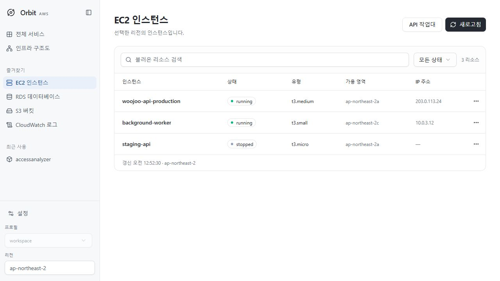

# Orbit

A desktop AWS resource browser built with **Tauri 2, Rust, React and TypeScript**.
Uses your locally installed AWS CLI and existing profiles.



## Features

- EC2 instances, RDS databases, S3 buckets and CloudWatch log groups.
- S3 folder navigation, prefix entry, paged file lists and object metadata.
- CloudWatch event bodies, stream names, time ranges, filter patterns and pagination.
- Profile/region selection and an STS account number to distinguish accounts.
- English and Korean interface, including explorer controls and dates.
- Light, Dark and System themes, including infrastructure diagrams and exports.
- Collapsible sidebar (`Ctrl+B`), persisted language and sidebar preferences.
- In-memory list cache and local search over loaded rows.

The four resource browsers are read-only. The API Runner supports real changes
only after enabling advanced actions for the current session and reviewing the
account, region, operation and exact input. Every execution requires a matching
confirmation phrase. AWS service/API charges can apply. CLI diagnostics and
resource data preserve their source language.

- Search the installed CLI service catalog (437 services on the development machine).
- Sidebar favorites (up to eight), recent services (five), and category filters.
- Settings: language, default region, table density, memory-cache clearing, session actions.
- Full resource detail pages; EC2 Name tag, RDS backup retention and log retention editors.
- Generic modeled API operations: option forms with required fields and AWS descriptions, optional skeleton, JSON editing,
  account-bound review and result viewer. Review expires after five minutes and is single-use.
- API Runner links directly to the selected operation's AWS CLI reference for
  input options and examples. Desktop links open in the default browser; opener
  permission is limited to the official AWS CLI reference URL path.

Binary/streaming APIs and custom CLI commands such as S3 sync require separate
adapters. File upload/download and object content previews remain unsupported.
The common workbench is single-page: supply service-native cursor fields in JSON
for additional pages. Some modeled APIs have CLI customizations that may reject a
request; not every AWS API has been exercised. Catalog discovery currently targets
the standard Windows AWS CLI v2 installation. Browser preview uses public catalog
metadata and sample operations; it cannot access AWS.

## Run on Windows

Install Node.js 22+, Rust with MSVC build tools, WebView2 and AWS CLI v2.

```powershell
npm ci
.\start.ps1
```

The launcher adds the standard Cargo directory to its process PATH and runs
`npm run tauri dev`. If Cargo is already on PATH, run that command directly.
Configure profiles externally with `aws configure` or `aws configure sso`.
For SSO, run `aws sso login --profile YOUR_PROFILE`.

Choose a profile and region to load resources; refresh when needed. The account ID is fetched on connection
and context changes. Two differently named profiles can point to the same account.

`npm run dev` starts a browser-only **sample-data preview**, with no AWS access.
Real queries require the desktop app.

## Build and test

```powershell
npm run build
cargo test --manifest-path src-tauri/Cargo.toml
npm run tauri build -- --no-bundle
```

The optimized Windows executable is `src-tauri/target/release/aws-gui.exe`.
This is a standalone executable build, not an installer; AWS CLI and WebView2
must be installed separately.

The live integration test is ignored by default. It performs real, read-only
AWS requests and emits counts, not resource bodies or credentials.

```powershell
$env:ORBIT_LIVE_PROFILE = 'YOUR_PROFILE'
$env:ORBIT_LIVE_REGION = 'ap-northeast-2'
$env:ORBIT_LIVE_BUCKET = 'YOUR_BUCKET'
$env:ORBIT_LIVE_LOG_GROUP = 'YOUR_LOG_GROUP'
cargo test --manifest-path src-tauri/Cargo.toml live_readonly -- --ignored --nocapture
```

## Validation

- React/TypeScript/Vite build, 61 frontend regression tests and 13 Rust unit tests.
- Live Rust integration: RDS, S3 and log group lists; S3 root and child folder;
  CloudWatch message bodies and the next page.
- Desktop UI: real EC2/RDS/S3/log group lists.
- Browser UI: sidebar collapse/expand, language switch and persistence after
  reload, S3 folder/file navigation, log body view and time/filter form.

The new explorer backend was verified against live AWS; explorer interactions
were checked using sample data in the browser. AWS latency, desktop startup and
memory usage have not been benchmarked.

## Architecture

The frontend uses a single React root with TypeScript throughout. shadcn/ui (Radix),
Tailwind CSS 4 and Lucide provide shared tables, sheets, tabs, menus, controls and icons.
Theme tokens live in `src/styles.css`; generated components live in `src/components/ui`.
The infrastructure canvas and image/PDF exporters load on demand.

The frontend invokes narrow Tauri commands. Rust builds allowlisted AWS CLI
argument arrays without a shell, caps concurrent processes at three, bounds
output and applies a 40-second request timeout. Credentials remain managed by
AWS CLI. Resource bodies and logs are not persisted.

See [design](docs/design.md) and [UI decisions](docs/ui-decisions.md).

## Windows installer and quality checks

Run `npm run check` for frontend regression tests and a production frontend build.
Run `npm run tauri build` for the per-user Windows NSIS installer. The installer
is currently unsigned. CI validates TypeScript, frontend tests, Rust tests,
formatting and Clippy before packaging an artifact.

See [release readiness](docs/release-readiness.md) for enforced runtime limits,
validation commands and the remaining requirements for public distribution.

## Context menus

Right-click resource rows, sidebar services, catalog cards, resource detail fields,
S3 objects/prefixes, log events and API operations/results for actions specific to
that item. Copy actions copy the clicked item's ID, URI, metadata or text. Editing
still enters the existing review flow; context menus do not execute cloud mutations.

Keyboard: use the Menu key or Shift+F10, arrows/Home/End to move, Enter/Space to
activate and Escape to close. Input fields and selected text retain their native
context menu. Menus close on outside click or removal of the target.
Clipboard failures are reported instead of showing a false success message.

## Infrastructure map

Open **Infrastructure map** in the sidebar, select **Select resources**, search and check resources, then press **Load**.
An empty search shows all discovered resources. Search changes preserve checked items; Cancel leaves the diagram unchanged.
By default, only selected resources and their VPC/subnet ancestors are drawn. Edges require both endpoints to be included.
Enable **Include connected resources** in the picker to follow confirmed relationships in either direction, including EC2 → target group → load balancer. Shared VPC/subnet membership alone does not expand the selection.
Initial discovery fetches resource lists. On Load, relationship details are queried for selected resources, or across the catalog when connected resources are enabled so reverse relationships can be discovered. Existing collection limits and warnings apply.
The selected profile and region are queried through fixed read-only CLI commands.
React Flow renders VPC/subnet groups, EC2, RDS, ELBv2, target groups and S3.
ELK.js automatically arranges the graph; nodes can also be dragged without changing AWS.
Icon, simple and detailed views, resource search, an inspector and a minimap are included.

Arrows represent configured associations, registered targets with health status,
ELB access-log destinations and S3 notification destinations. They do not prove
application traffic or network reachability. RDS instances are grouped by VPC;
a DB subnet group is not treated as an instance's exact subnet. Classic ELB,
security-group reachability and application configuration are outside this collector.
Buckets in other regions are excluded unless referenced as a log destination.
Buckets whose region cannot be read are marked unverified.

Collection keeps partial results and reports permission errors and truncation.
Each inventory query is capped at five CLI pages, relationship enrichment at 200
resources, and diagrams at 1,000 nodes. Counts describe collected inventory.
Changing profiles or leaving the page discards pending results. Account identity
is checked before and after collection. Snapshots are not persisted automatically.

PNG and PDF exports include the full diagram in the selected view, including
manually adjusted positions. Desktop exports use a native Save dialog, with
cancellation and filesystem errors reported. Browser exports provide a download
link. Images are capped at 6,000 pixels per side and 16 megapixels; PDFs contain
the rendered image on one custom-sized page, not editable vector nodes.
The desktop saver accepts PNG/PDF signatures only and caps files at 24 MiB.
Exports are the only files written by the diagram feature.

The diagram and export libraries are loaded on demand. Open-source dependencies:
React / React Flow (MIT), ELK.js (EPL-2.0), html-to-image (MIT), jsPDF (MIT),
and rfd (MIT). See each package's distributed license.

The interface uses locally bundled Pretendard Variable 1.3.9 (SIL OFL 1.1),
including diagram labels. Code and JSON retain monospace fonts. The font license
is distributed at `public/licenses/Pretendard-OFL.txt`.
All selection fields use shadcn Select (Radix), with themed popup menus, keyboard
navigation and the same bundled font as the interface.

`tests/topology-browser.html` is an isolated synthetic browser test fixture,
excluded from the production entry point. `docs/infrastructure-map.png` and
`docs/infrastructure-export.png` show that fixture, not an AWS account.
For a real read-only collector smoke test:
`ORBIT_LIVE_PROFILE=<profile> ORBIT_LIVE_REGION=<region> cargo test --manifest-path src-tauri/Cargo.toml live_readonly_topology -- --ignored --nocapture`.
