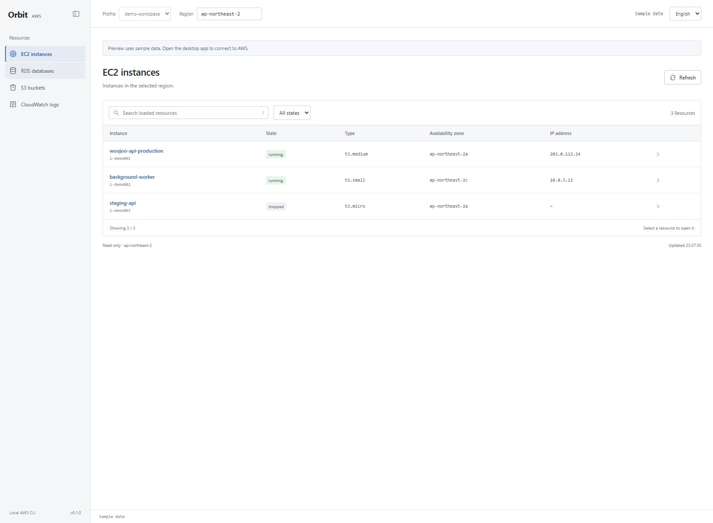

# Orbit

A desktop AWS resource browser built with **Tauri 2, Rust and TypeScript**.
Uses your locally installed AWS CLI and existing profiles.



## Features

- EC2 instances, RDS databases, S3 buckets and CloudWatch log groups.
- S3 folder navigation, prefix entry, paged file lists and object metadata.
- CloudWatch event bodies, stream names, time ranges, filter patterns and pagination.
- Profile/region selection and an STS account number to distinguish accounts.
- English and Korean interface, including explorer controls and dates.
- Collapsible sidebar (`Ctrl+B`), persisted language and sidebar preferences.
- In-memory list cache and local search over loaded rows.

All AWS operations are read-only. AWS service/API charges can still apply.
S3 file download, upload and content previews are not implemented. EC2/RDS
resource details use the original JSON response. CLI diagnostics and resource
data preserve their source language.

## Run on Windows

Install Node.js 22+, Rust with MSVC build tools, WebView2 and AWS CLI v2.

```powershell
npm ci
.\start.ps1
```

The launcher adds the standard Cargo directory to its process PATH and runs
`npm run tauri dev`. If Cargo is already on PATH, run that command directly.
Configure profiles externally with `aws configure` or `aws configure sso`.
For SSO, run `aws sso login --profile YOUR_PROFILE`.

Choose a profile and region, then refresh. The account ID is fetched on connection
and context changes. Two differently named profiles can point to the same account.

`npm run dev` starts a browser-only **sample-data preview**, with no AWS access.
Real queries require the desktop app.

## Build and test

```powershell
npm run build
cargo test --manifest-path src-tauri/Cargo.toml
npm run tauri build -- --no-bundle
```

The optimized Windows executable is `src-tauri/target/release/aws-gui.exe`.
This is a standalone executable build, not an installer; AWS CLI and WebView2
must be installed separately.

The live integration test is ignored by default. It performs real, read-only
AWS requests and emits counts, not resource bodies or credentials.

```powershell
$env:ORBIT_LIVE_PROFILE = 'YOUR_PROFILE'
$env:ORBIT_LIVE_REGION = 'ap-northeast-2'
$env:ORBIT_LIVE_BUCKET = 'YOUR_BUCKET'
$env:ORBIT_LIVE_LOG_GROUP = 'YOUR_LOG_GROUP'
cargo test --manifest-path src-tauri/Cargo.toml live_readonly -- --ignored --nocapture
```

## Validation

- TypeScript/Vite build and five Rust unit tests.
- Live Rust integration: RDS, S3 and log group lists; S3 root and child folder;
  CloudWatch message bodies and the next page.
- Desktop UI: real EC2/RDS/S3/log group lists.
- Browser UI: sidebar collapse/expand, language switch and persistence after
  reload, S3 folder/file navigation, log body view and time/filter form.

The new explorer backend was verified against live AWS; explorer interactions
were checked using sample data in the browser. AWS latency, desktop startup and
memory usage have not been benchmarked.

## Architecture

The frontend invokes narrow Tauri commands. Rust builds allowlisted AWS CLI
argument arrays without a shell, caps concurrent processes at three, bounds
output and applies a 40-second request timeout. Credentials remain managed by
AWS CLI. Resource bodies and logs are not persisted.

See [design](docs/design.md) and [UI decisions](docs/ui-decisions.md).

## Windows installer and quality checks

Run `npm run check` for frontend regression tests and a production frontend build.
Run `npm run tauri build` for the per-user Windows NSIS installer. The installer
is currently unsigned. CI validates TypeScript, frontend tests, Rust tests,
formatting and Clippy before packaging an artifact.

See [release readiness](docs/release-readiness.md) for enforced runtime limits,
validation commands and the remaining requirements for public distribution.
